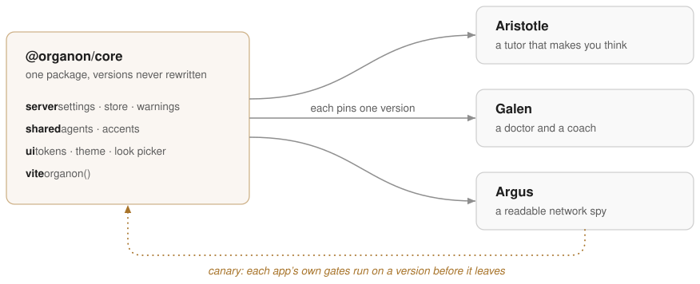

<p align="center">
  <picture>
    <source media="(prefers-color-scheme: dark)" srcset="docs/images/banner-dark.svg">
    
  </picture>
</p>

<p align="center">
  <a href="#what-an-app-gets">What an app gets</a> ·
  <a href="#use-it">Use it</a> ·
  <a href="#release-a-version">Release a version</a> ·
  <a href="#the-apps">The apps</a>
</p>

<p align="center">
  <a href="https://github.com/Di0go/organon/releases/latest"></a>
  
  
  
  <a href="LICENSE"></a>
</p>

---

**Organon is the core that [Aristotle](https://github.com/Di0go/aristotle), Galen and Argus are built on.** What the
three share is written once, here: settings, storage, the design tokens and the look, and in time the agent bridge,
chat and the MCP server. A fix made here reaches every app, and no app moves until it chooses to: each pins one exact
version, and before a version leaves, every app's own checks run against it.

Named after Aristotle's works on logic, the instrument the rest was built with. Built for one person, and open in
case it is useful to another.

<p align="center">
  <picture><source media="(prefers-color-scheme: dark)" srcset="docs/images/core-dark.svg"></picture>
</p>

## What an app gets

One package, `@organon/core`, with a path for each part. The server's parts ship compiled; the interface ships as
source, served by the `organon()` Vite plugin.

| | Import | What it does |
|---|---|---|
| **Settings** | `server/settings` | The app's `settings.json`, with its own keys beside the core's. A file that can't be read or parsed is set aside and said, never written over. |
| **Storage** | `server/store` | JSON files and append-only logs in the app's `data/`, written atomically and in turn. |
| **Warnings** | `server/warnings` | What went wrong on the server, kept for the interface to show. |
| **Agents, accents** | `shared/agents`, `shared/accents` | Who runs the app's agent (Claude Code, another agent CLI, or a model behind an OpenAI-compatible API), and the accents an app can wear. |
| **Tokens** | `ui/tokens.css` | Colour, type, radii and widths, light and dark, with chart series that stay apart for colour-blind eyes. |
| **The look** | `ui/theme`, `ui/LookPicker.svelte` | Light, dark or system, and the accent, set before the first paint. |
| **Vite** | `vite` | `organon()`: serves the look's boot script and keeps the core's source out of pre-bundling. |

## Use it

Pin a release by its URL. The lockfile keeps the tarball's hash, so a version can never change under an app.

```sh
pnpm add https://github.com/Di0go/organon/releases/download/v0.3.0/organon-core-0.3.0.tgz
```

Then wire it in, as [`examples/minimal`](examples/minimal) does:

```ts
// vite.config.ts
import { organon } from '@organon/core/vite';
export default defineConfig({ plugins: [svelte(), organon()] });

// ui/src/main.ts
import '@organon/core/ui/tokens.css';

// server/index.ts: the core, bound to this app's folders
const warnings = new Warnings();
const settings = createSettings({ file: SETTINGS_FILE, warnings, apiKey: process.env.MYAPP_API_KEY });
const store = createStore({ dataDir: DATA_DIR, warnings });
```

```html
<!-- ui/index.html: the app's key and default accent, before the first paint -->
<script src="/theme-boot.js" data-key="myapp.look" data-accent="violet"></script>
```

What changes between versions, and what an app must do to move, is in [CHANGELOG.md](packages/core/CHANGELOG.md).

## Release a version

A fix is made here first, with a test that fails before it. Then, in order:

| Command | What it does |
|---|---|
| `pnpm gates` | Lint, types, the core's tests, and the canary: every app's own checks on a throwaway copy, with this working tree's core |
| `pnpm pack:release` | Packs the version in `packages/core/package.json` into `releases/`, and never rewrites one |
| `pnpm publish:release` | After a push: a GitHub release on that commit, the tarball attached and checked back |

Before packing, the version goes up and `CHANGELOG.md` says what an app must change. `pnpm canary <app>… [--run "<cmd>"]` tries the core on one app alone. Why it is shaped this way, and
the order the apps move in, is in [docs/plano.md](docs/plano.md) (in Portuguese).

## The apps

| App | What it is | On the core |
|---|---|---|
| [Aristotle](https://github.com/Di0go/aristotle) | A tutor that makes you think, then makes you do | Third, after Galen |
| Galen | A doctor and a coach | Second |
| Argus | A readable network spy, on `tshark` | First, born on it |
| [`examples/minimal`](examples/minimal) | The smallest app on the core, at the size of a test | 0.3.0, in every gate |

## License

[MIT](LICENSE).
